<div align="center">

# LarkAura

**Ambient, click-through weather for your Linux desktop.**

Snow that piles up on your windows, rain with distant lightning, drifting leaves and petals,
fireflies and falling stars, drawn on a transparent layer that never gets in the way of your
clicks.

[](LICENSE)


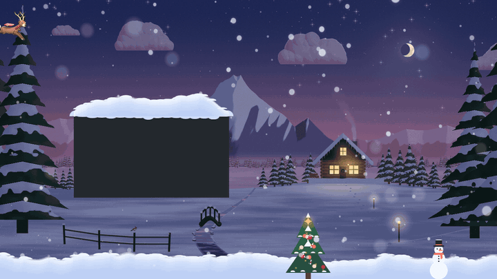

</div>

---

## Contents

- [What is LarkAura?](#what-is-larkaura)
- [Features](#features)
- [Gallery](#gallery)
- [Requirements](#requirements)
- [Installation](#installation)
- [Usage](#usage)
- [Configuration](#configuration)
- [Troubleshooting](#troubleshooting)
- [Build from source](#build-from-source)
- [Project layout](#project-layout)
- [Contributing](#contributing)
- [License](#license)

## What is LarkAura?

LarkAura adds a gentle, living atmosphere on top of your desktop. Pick an **aura** (a kind of
weather or mood) and it plays across your screen while you work: snow builds up along the tops
of your windows and slides off when you move them, leaves tumble and settle, fireflies gather
where your pointer rests.

What makes it different from an animated wallpaper:

- **It reacts to your desktop.** Effects land on windows, fall when you drag them, scatter
  from your pointer, and pause when you go full screen.
- **It never blocks you.** The effects layer is click-through from its very first frame. Every
  click, scroll and keystroke goes to the window underneath.
- **It stays out of your work.** By default effects stay on the desktop and along window tops,
  never over what is inside your windows.
- **It is light.** Rendering runs on the GPU in a separate process, at about 2% of one CPU core,
  and slows down or pauses while you work, on battery, or when nothing is visible.
- **It can't take your desktop down.** GNOME Shell only hosts a small extension. If the
  renderer ever crashes, the extension restarts it and your session carries on.

## Features

- **10 built-in auras:** First Light, Quiet Snow, Deep Snow, Soft Rain, Night Storm,
  Autumn Leaves, Blossom Drift, Falling Stars, Fireflies and Low Fog.
- **Living snow:** layered flakes with wind and gusts, drifts along the bottom of the screen,
  soft caps on window tops that are thrown off when a window moves.
- **Snow play:** press and hold on the snow to pack a snowball, drag to roll it bigger, release
  to throw it. Stack three to build a snowman.
- **Visitors:** a sleigh and a snowplough during snow, plus a small visitor for every weather: a
  penguin, fox or snowy owl in the snow, a frog in the rain, butterflies among the blossom, a
  comet with the falling stars, and more. They come by on their own or when you call them.
- **Decorations:** up to three decorated trees standing along the bottom of the screen.
- **Illustrated wallpapers:** nine scenes drawn entirely from code, each at eight times of day
  or changing through the day, with an option to switch the wallpaper to match the weather.
- **Three placement modes:** on the desktop only, behind all windows, or everywhere.
- **Power aware:** Battery, Balanced and Best quality, "Stillness" while you type, pause in full
  screen, and reduce or pause on battery.
- **Multi-monitor:** one overlay per display, each of which can be turned off from the menu.
- **LarkAura Studio:** a settings app with live previews, plus a quick menu in the top bar.

## Gallery

### Auras

| | |
|:---:|:---:|
| 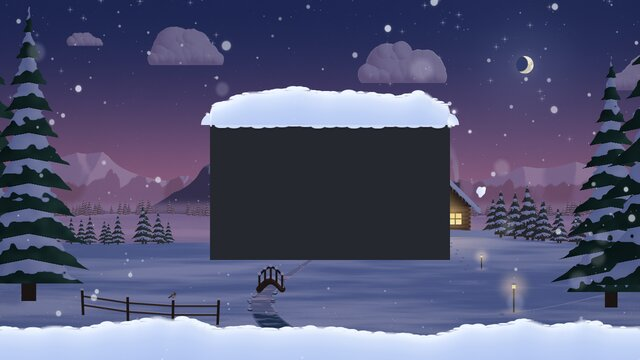<br>**Quiet Snow** | 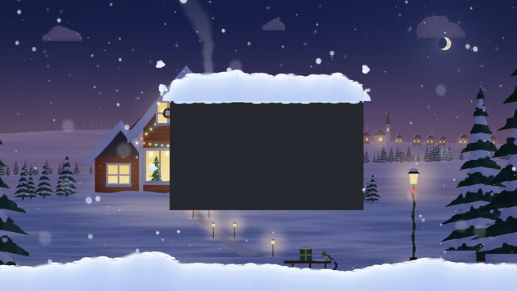<br>**Deep Snow** |
| 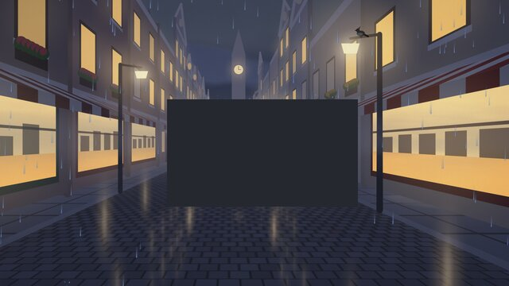<br>**Soft Rain** | 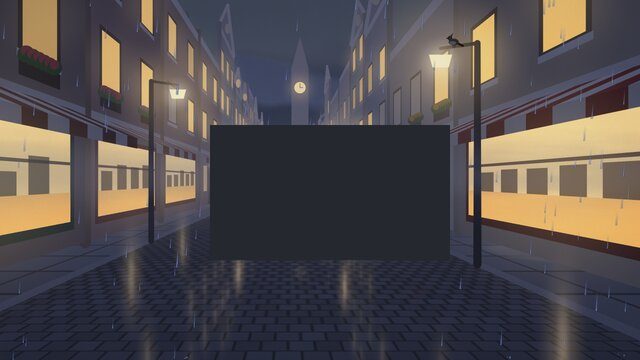<br>**Night Storm** |
| 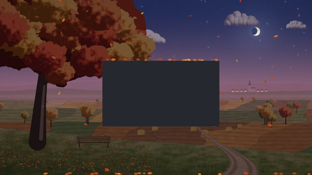<br>**Autumn Leaves** | 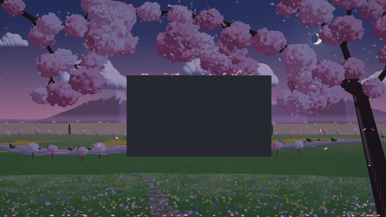<br>**Blossom Drift** |
| 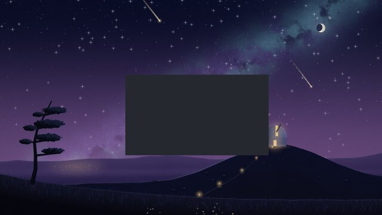<br>**Falling Stars** | 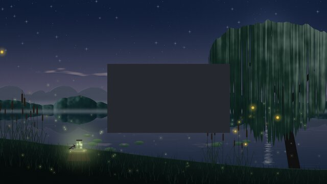<br>**Fireflies** |
| 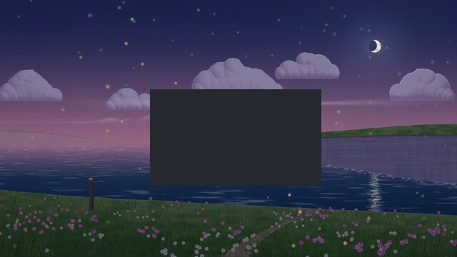<br>**First Light** | 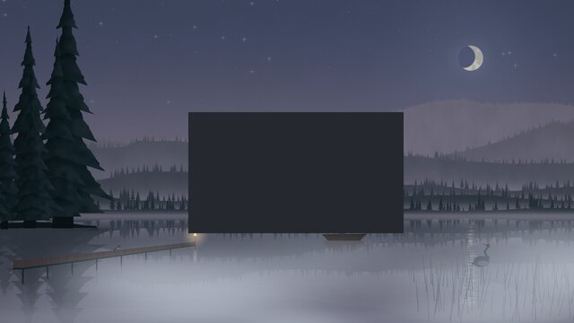<br>**Low Fog** |

<sub>The dark rectangle stands in for an open window. These frames come from the project's own
CPU preview tool (`snapshot`); on a real desktop the effects are drawn by the GPU.</sub>

### Wallpapers

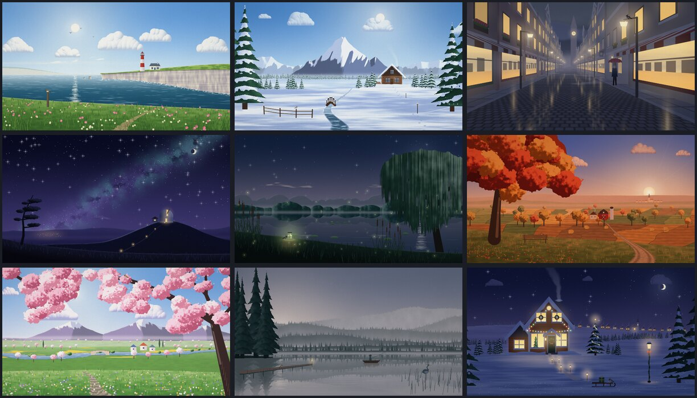

<sub>Left to right, top to bottom: Lark Cliffs, Winter Hollow, Rainy Lane, Star Ridge,
Firefly Pond, Harvest Valley, Blossom Valley, Misty Lake and Christmas Eve.</sub>

### LarkAura Studio

| Atmosphere | Decorations | Wallpaper |
|:---:|:---:|:---:|
| 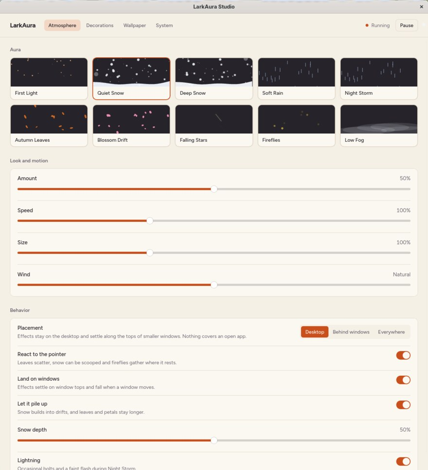 | 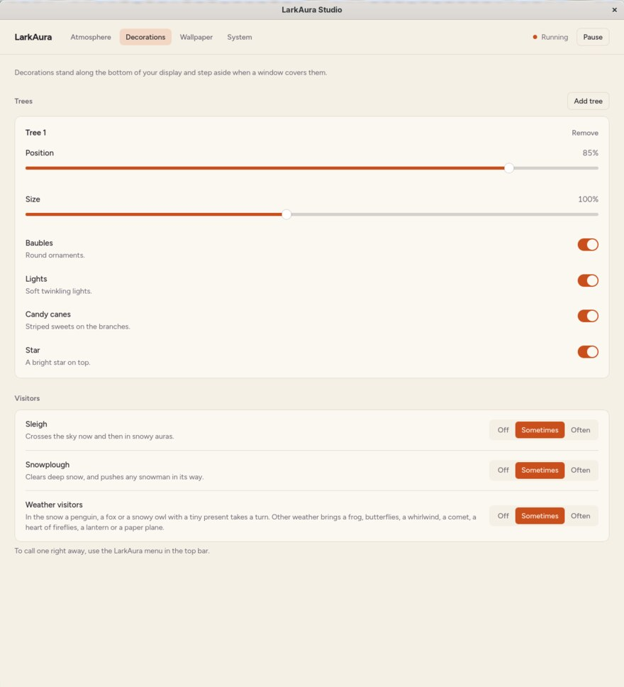 | 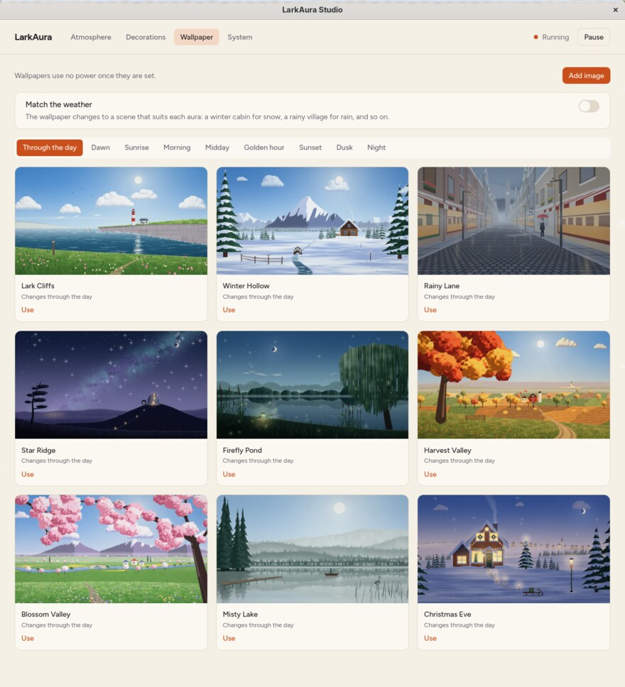 |

## Requirements

| | |
|---|---|
| **Desktop** | GNOME Shell **50** in a **Wayland** session |
| **Graphics** | A GPU with a Vulkan driver (Mesa for Intel and AMD, or the NVIDIA driver) |
| **Architecture** | x86_64 (other architectures should build but are untested) |

**Tested on:** Fedora 44 Workstation (GNOME 50.6, Intel Iris Xe).
Other distributions that ship GNOME Shell 50 should work, but have not been tested yet.

**Not supported yet:** X11 sessions, GNOME versions other than 50, KDE Plasma, Hyprland, Sway,
Windows and macOS. See [docs/STATUS.md](docs/STATUS.md) for exactly what has been verified.

> [!NOTE]
> LarkAura is an early release. Its checks so far have run in an automated, headless GNOME
> session rather than on a wide range of real hardware. Reports from your setup are very
> welcome.

## Installation

LarkAura is installed from source, for your user only. Nothing is written outside your home
folder and no `sudo` is needed for the install itself.

**1. Install the build tools** for your distribution, as listed under
[Build dependencies](#build-dependencies).

**2. Clone and install:**

```bash
git clone https://github.com/peteriishak/LarkAura.git
cd LarkAura
packaging/linux/install.sh
```

The script builds Studio's front end and the release binaries (the first build takes a few
minutes), then installs:

- `larkaura-engine`, `larkaura-studio` and `larkaura-wallpaper` into `~/.local/bin`
- the GNOME Shell extension into `~/.local/share/gnome-shell/extensions/larkaura@larklabs.dev`
- a **LarkAura Studio** launcher in your app grid

**3. Log out and back in.** GNOME only loads new extensions at login. After that, LarkAura starts
on its own and its icon appears in the top bar.

### Updating

```bash
cd LarkAura
git pull
packaging/linux/install.sh
```

Then log out and back in to load the new extension.

### Uninstalling

If LarkAura changed your wallpaper, first open **Studio → Wallpaper → Restore my wallpaper**.
Then:

```bash
packaging/linux/install.sh --remove
```

This removes the programs, the extension and the launcher, and keeps your settings. To remove
those as well:

```bash
rm -rf ~/.config/larkaura ~/.local/share/larkaura
```

## Usage

### The top bar menu

Click the LarkAura icon in the top bar to:

- turn **Effects** on or off
- switch between auras (Snow, Rain, Autumn Leaves, Blossom, Fireflies, Falling Stars)
- send a visitor: the **sleigh** or **snowplough** (during snow), a **weather visitor**, or
  **shake off** the snow and leaves that have built up
- turn effects off on individual displays (shown when you have more than one)
- turn **Wallpaper Matches the Weather** on or off
- open **LarkAura Studio**

### LarkAura Studio

Open **LarkAura Studio** from the app grid or the top bar menu. Changes apply immediately.

| Page | What you can do |
|---|---|
| **Atmosphere** | Choose an aura, adjust amount, speed, size and wind, and set placement and behavior |
| **Decorations** | Add up to three trees, and choose how often the sleigh, snowplough and visitors come by |
| **Wallpaper** | Apply an illustrated scene at a fixed time of day or changing through the day, add your own image, match the weather, or restore your original wallpaper |
| **System** | Quality, battery behavior, Stillness, and the status of each component |

### Playing in the snow

During Quiet Snow or Deep Snow, with **React to the pointer** on:

- **Move** the pointer through lying snow to brush it away.
- **Press and hold** on the snow for about half a second to pack a snowball.
- **Drag** while holding to roll it bigger, then **release** while moving to throw it.
- **Release without moving** to set it down. Three in one spot make a snowman.

Presses inside a window are ignored, so normal clicking never picks up snow.

## Configuration

Everything can be set from Studio. Settings are stored in `~/.config/larkaura/settings.json`,
which the extension watches, so hand edits apply immediately. Out-of-range values are replaced
with safe defaults.

### Auras

| Aura | Effect | Pairs with wallpaper |
|---|---|---|
| First Light | Slow, glowing motes | Lark Cliffs |
| Quiet Snow | Light snowfall, drifts and window caps | Winter Hollow |
| Deep Snow | Heavy snowfall that builds deep drifts | Christmas Eve |
| Soft Rain | Gentle rain with splashes | Rainy Lane |
| Night Storm | Heavy, wind-blown rain with lightning | Rainy Lane |
| Autumn Leaves | Tumbling leaves that settle and scatter | Harvest Valley |
| Blossom Drift | Drifting cherry petals | Blossom Valley |
| Falling Stars | Meteors that spark on window edges | Star Ridge |
| Fireflies | Wandering lights that gather at your pointer | Firefly Pond |
| Low Fog | Slow banks of mist | Misty Lake |

Auras are small TOML files in [`auras/`](auras). The format is documented in
[docs/AURA-FORMAT.md](docs/AURA-FORMAT.md).

### Options

| Option | Values | Default | What it does |
|---|---|---|---|
| Amount | 0 to 100% | per aura | How much is on screen |
| Speed | 25 to 250% | 100% | How fast things fall and drift |
| Size | 50 to 200% | 100% | Particle size |
| Wind | calm to strong, either way | Natural | Overrides the aura's own wind |
| Placement | Desktop, Behind windows, Everywhere | Desktop | Where effects may appear |
| React to the pointer | on / off | on | Snow can be brushed and scooped, leaves scatter, fireflies gather |
| Land on windows | on / off | on | Effects settle on window tops and fall when a window moves |
| Let it pile up | on / off | on | Snow builds into drifts, leaves and petals stay longer |
| Snow depth | 0 to 100% | 50% | How deep drifts may grow (snow auras) |
| Lightning | on / off | on | Bolts and a faint flash during Night Storm |
| Quality | Battery (20 fps), Balanced (30 fps), Best (60 fps) | Balanced | Frame rate and render resolution |
| On battery | Reduce, Pause, No change | Reduce | Reduce halves the particles and uses Battery quality |
| Stillness | on / off | on | Effects fade while you work and return when you pause |
| Sleigh, Snowplough, Visitors | Off, Sometimes, Often | Sometimes | How often visitors come by on their own |
| Match the weather | on / off | off | Switch the wallpaper to suit each aura |

Effects also pause automatically when the screen is locked, when an app is full screen, and
when windows cover the whole desktop.

## Troubleshooting

<details>
<summary><b>The installer says "LarkAura has only been tested on GNOME 50"</b></summary>

The extension currently declares support for GNOME Shell 50 only, and the installer stops on
other versions to avoid loading untested code into your Shell. Check your version with
`gnome-shell --version`. Support for other versions is tracked in the issue tracker.
</details>

<details>
<summary><b>Nothing appears after installing</b></summary>

1. Log out and back in. GNOME loads new extensions only at login.
2. Make sure you are in a Wayland session: `echo $XDG_SESSION_TYPE` should print `wayland`.
3. Check the extension is enabled: `gnome-extensions info larkaura@larklabs.dev` should show
   `State: ACTIVE`. If not, run `gnome-extensions enable larkaura@larklabs.dev`, or turn it on
   in the Extensions app, and make sure user extensions are not disabled globally.
4. Make sure effects are not paused: open the top bar menu and check **Effects** is on.
</details>

<details>
<summary><b>"The renderer keeps stopping, so effects are off for now"</b></summary>

The engine failed several times in a row. The most common cause is a missing Vulkan driver.

- Check Vulkan works: `vulkaninfo --summary` (from the `vulkan-tools` package) should list your
  GPU. Install your distribution's Mesa Vulkan drivers (for example `mesa-vulkan-drivers`) or
  the NVIDIA driver.
- LarkAura refuses to run on a software renderer (llvmpipe), which would drain your battery.
- Look at the logs: `journalctl -b --no-pager | grep -i larkaura | tail -50`

After fixing the cause, turn **Effects** off and on again from the top bar menu.
</details>

<details>
<summary><b>"The renderer is not installed" or "LarkAura Studio is not installed"</b></summary>

The extension could not find the programs in `~/.local/bin`. Run `packaging/linux/install.sh`
again from the repository.
</details>

<details>
<summary><b>Effects cover my windows</b></summary>

Set **Placement** to **Desktop** (the default) or **Behind windows** in Studio's Atmosphere
page. Clicks always pass through in every mode.
</details>

<details>
<summary><b>High CPU or GPU use</b></summary>

Choose **Battery** or **Balanced** quality on Studio's System page, keep **Stillness** on, and
lower **Amount**. Very large displays use the most GPU time; Balanced quality automatically
drops to 24 fps above 2560×1600.
</details>

<details>
<summary><b>My wallpaper changed and I want the old one back</b></summary>

Open **Studio → Wallpaper → Restore my wallpaper**, and turn off **Match the weather** so it is
not changed again.
</details>

<details>
<summary><b>The build fails</b></summary>

- `webkit2gtk-4.1` or `libsoup-3.0` not found: install the development packages listed under
  [Build dependencies](#build-dependencies).
- `wayland-client` not found: install the Wayland development package.
- Rust errors about the 2024 edition or unknown features: update Rust with `rustup update`.
  Distribution Rust packages are sometimes too old.
- npm or Vite errors: use Node.js 22 or newer.
</details>

Still stuck? [Open an issue](https://github.com/peteriishak/LarkAura/issues) with your
distribution, `gnome-shell --version`, your GPU, and the output of the log command above.

## Build from source

### Build dependencies

You need a recent stable **Rust** toolchain (install with [rustup](https://rustup.rs)),
**Node.js 22+** with npm, a C compiler, `pkg-config`, and the Wayland and WebKitGTK development
packages.

**Fedora** (tested):

```bash
sudo dnf install gcc pkgconf-pkg-config wayland-devel webkit2gtk4.1-devel gtk3-devel \
  libsoup3-devel nodejs npm
```

**Debian / Ubuntu:**

```bash
sudo apt install build-essential pkg-config libwayland-dev libwebkit2gtk-4.1-dev \
  libgtk-3-dev libsoup-3.0-dev nodejs npm
```

**Arch Linux:**

```bash
sudo pacman -S --needed base-devel wayland webkit2gtk-4.1 gtk3 libsoup3 nodejs npm
```

### Building and testing

```bash
cargo test                                              # unit tests
cargo clippy --workspace --all-targets -- -D warnings   # lints (needs the Studio front end built)
(cd apps/studio && npm ci --ignore-scripts && npm run build)
cargo build --release -p larkaura-engine -p larkaura-studio -p aura-wallpaper --bins
```

Preview effects and wallpapers without a desktop:

```bash
cargo run --release -p aura-effects --example snapshot -- /tmp/shots quiet-snow 4 8 12
cargo run --release -p aura-wallpaper --example render_scenes -- /tmp/scenes
```

LarkAura also has an isolated, headless GNOME Shell test harness that drives the real
extension, engine and Studio without touching your desktop. See
[docs/TESTING.md](docs/TESTING.md).

## Project layout

```
LarkAura/
├── apps/
│   ├── engine/              # larkaura-engine: the renderer process
│   └── studio/              # LarkAura Studio (Tauri 2, React, TypeScript, Tailwind)
├── crates/
│   ├── aura-core/           # shared types: desktop model, settings, power states
│   ├── aura-effects/        # the simulation: particles, snow, visitors, sprites
│   ├── aura-format/         # the aura file format and built-in auras
│   ├── aura-ipc/            # the engine's stdin control protocol
│   ├── aura-render/         # wgpu renderer and WGSL shader
│   ├── aura-settings/       # the shared settings file
│   └── aura-wallpaper/      # procedural wallpaper scenes and the wallpaper helper
├── platform/
│   ├── linux-gnome/         # the GNOME Shell extension
│   └── linux-wayland/       # the click-through Wayland surface
├── auras/                   # the ten built-in aura files
├── art/visitors/            # Blender source for the visitor sprites
├── packaging/linux/         # per-user installer
├── tests/gnome-shell/       # isolated headless GNOME Shell test harness
└── docs/                    # architecture, aura format, testing, status
```

How the pieces fit together is described in [docs/ARCHITECTURE.md](docs/ARCHITECTURE.md).

## Contributing

Contributions are welcome: bug reports, testing on new hardware and distributions, new auras,
wallpaper scenes and code. Please read [CONTRIBUTING.md](CONTRIBUTING.md) before opening a pull
request.

- [Report a bug](https://github.com/peteriishak/LarkAura/issues/new?template=bug_report.md)
- [Suggest a feature](https://github.com/peteriishak/LarkAura/issues/new?template=feature_request.md)
- [Changelog](CHANGELOG.md)
- [Project status and tested setups](docs/STATUS.md)

## License

LarkAura is free software, released under the
[GNU General Public License v3.0 or later](LICENSE).

The wallpaper scenes and visitor sprites are original artwork made for LarkAura and are covered
by the same license. Studio bundles the [Figtree](https://github.com/erikdkennedy/figtree)
typeface, which is licensed under the SIL Open Font License 1.1.
